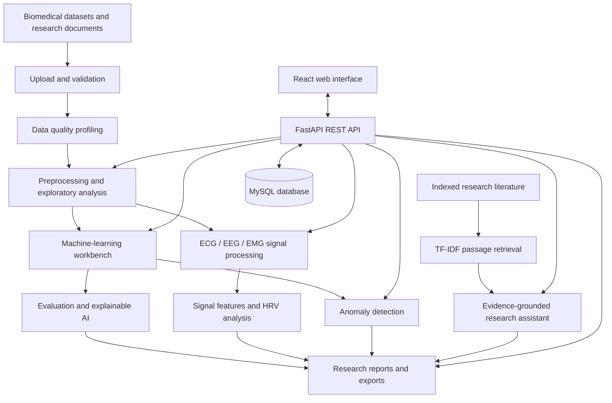

# MedInsight AI
### From Biomedical Data to Intelligent Insight.

**MedInsight AI** is a software-only biomedical data science and research platform developed by **BioIntelliX**, with the team led by **Mr. Satyam Kumar Shrivastav**.

> **Leadership attribution:** “Mr. S. K. Shrivastav” refers to **Mr. Satyam Kumar Shrivastav**.

MedInsight AI brings biomedical dataset quality assessment, preprocessing, exploratory analysis, machine learning, explainable AI (XAI), physiological signal processing, anomaly detection, evidence-grounded literature retrieval, and research reporting into one web-based workflow.

> **Important medical disclaimer:** MedInsight AI is an academic and research-oriented software platform. It provides data-driven analytical insights, digital signal processing, and model-generated predictions using biomedical datasets. It is not a certified medical diagnostic system, does not replace qualified healthcare professionals, and must not be used as the sole basis for clinical diagnosis, patient management, or medication prescription.

---

## Contents

- [Project at a glance](#project-at-a-glance)
- [Objectives](#objectives)
- [Key features](#key-features)
- [System architecture](#system-architecture)
- [Technology stack](#technology-stack)
- [Application modules](#application-modules)
- [Machine learning and evaluation](#machine-learning-and-evaluation)
- [Biomedical signal processing](#biomedical-signal-processing)
- [Explainable AI](#explainable-ai)
- [Research assistant and citations](#research-assistant-and-citations)
- [Security and access control](#security-and-access-control)
- [Project structure](#project-structure)
- [Prerequisites](#prerequisites)
- [Installation and local setup](#installation-and-local-setup)
- [Configuration](#configuration)
- [Running tests](#running-tests)
- [Datasets and research ethics](#datasets-and-research-ethics)
- [Limitations and responsible use](#limitations-and-responsible-use)
- [Documentation](#documentation)
- [Team and attribution](#team-and-attribution)
- [Acknowledgements](#acknowledgements)
- [License](#license)

---

## Project at a glance

| Item | Details |
|---|---|
| Project | MedInsight AI |
| Tagline | From Biomedical Data to Intelligent Insight. |
| Organization | BioIntelliX |
| Team lead | Mr. Satyam Kumar Shrivastav |
| Project type | Software-only web application |
| Domains | Biomedical data science, digital signal processing, machine learning, explainable AI, research assistance |
| Frontend | React, TypeScript, Vite, Tailwind CSS |
| Backend | Python, FastAPI, Pydantic |
| Database | MySQL 8.0 / compatible MariaDB configuration |
| Testing framework | Pytest |
| Intended users | Students, researchers, staff, administrators, and educational users |

## Objectives

- Consolidate common biomedical data analysis workflows in a single web application.
- Help users inspect data quality before modeling.
- Provide configurable preprocessing and exploratory data analysis.
- Train and evaluate machine-learning models with safeguards against data leakage.
- Present model behavior using explainability techniques.
- Support ECG, EEG, and EMG signal analysis using software-based processing.
- Identify unusual records for further human review.
- Retrieve relevant passages from indexed research documents and present source-linked answers.
- Produce structured, reproducible reports for academic and research workflows.

## Key features

### 1. Biomedical data quality
- Missing-value summaries and missingness patterns.
- Duplicate-row and constant/zero-variance feature checks.
- Column profiling and dataset health scoring.
- Quality findings to guide preprocessing decisions.

### 2. Preprocessing and exploratory analysis
- Imputation, encoding, and feature scaling.
- Reusable preprocessing pipelines and serialized artifacts where configured.
- Descriptive statistics, distributions, histograms, and correlation analysis.
- Biomedical aggregations for selected clinical variables.

### 3. Machine-learning workbench
- Classification and regression workflows, where supported by the dataset and task.
- Cross-validation and multi-metric model evaluation.
- Experiment and hyperparameter records.
- Saved model artifacts for supported inference workflows.

### 4. Explainable AI (XAI)
- Global feature-importance summaries.
- Local feature attributions using supported SHAP explainers.
- Visualizations intended to help users inspect how model inputs influence a prediction.

### 5. Biomedical signal processing
- Configurable filtering for supported physiological signals.
- Power-line interference suppression and baseline-wander processing.
- Pan–Tompkins-style QRS/R-peak detection.
- Time- and frequency-domain heart-rate variability (HRV) summaries when signal quality and recording duration are adequate.

### 6. Anomaly detection
- Unsupervised anomaly detection with Isolation Forest and Local Outlier Factor (LOF).
- Scores and flags to help prioritize records for further inspection.

### 7. Research assistant
- Ingestion of supported research documents, such as PDF and TXT.
- Hierarchical text chunking and TF-IDF-based passage retrieval.
- Answers grounded in retrieved passages, with available paper metadata and citations.
- A research workflow that should acknowledge when indexed evidence is insufficient.

### 8. Reporting and exports
- PDF research reports using ReportLab.
- CSV, XLSX, and JSON exports where implemented.
- Report metadata, evaluation summaries, methodology, limitations, and medical-use disclaimers.

### 9. Role-based access and audit records
- Role-specific access to application capabilities.
- Administrative approval workflows for configured account actions.
- Activity logging for supported security and research operations.

---

## System architecture

The intended high-level workflow is:



### Architectural layers

1. **Presentation layer:** React and TypeScript web interface with responsive navigation and interactive visualizations.
2. **API layer:** FastAPI endpoints for authentication, data management, analytics, modeling, signal processing, research assistance, and reports.
3. **Computational layer:** Python-based data science, machine learning, explainability, and signal-processing components.
4. **Persistence layer:** MySQL-compatible database for application records and metadata; local or configured storage for datasets, model artifacts, and generated reports.
5. **Governance layer:** Authentication, role-based authorization, approval workflows, and activity records.

The diagram describes the intended system design. Check the actual repository configuration and implementation before assuming that every component is enabled in a given deployment.

## Technology stack

| Area | Technologies specified for the project |
|---|---|
| Frontend | React 19, TypeScript, Vite |
| Styling and UI | Tailwind CSS, Lucide React |
| Charts | Recharts |
| Navigation and HTTP | React Router, Axios |
| Backend | Python 3.11+, FastAPI, Uvicorn |
| Validation and settings | Pydantic v2, Pydantic Settings |
| ORM and database | SQLAlchemy 2.0, PyMySQL, MySQL 8.0 / MariaDB |
| Data processing | NumPy, Pandas |
| Machine learning | scikit-learn, XGBoost, LightGBM |
| Explainability | SHAP |
| Signal processing | SciPy |
| Artifact serialization | Joblib |
| PDF generation | ReportLab |
| Spreadsheet exports | OpenPyXL |
| Authentication | bcrypt-compatible password hashing, JWT (HS256 as specified) |
| Testing | Pytest, FastAPI TestClient |

Refer to the dependency manifests in the repository for the exact installed versions. The table records the specified stack, not a substitute for checking lock files or package metadata.

## Application modules

The project plan describes the following areas of the web application:

| Area | Capabilities |
|---|---|
| Public and account pages | Landing page, login, registration, password recovery, profile |
| Data management | Dashboard, datasets, quality assessment, preprocessing, EDA, biomedical analytics |
| ML and XAI | Model training, evaluation, prediction, explanations, anomaly detection, experiments |
| Signals and research | Signal analysis, research assistant, document library, reports |
| Governance and help | User administration, activity logs, help/documentation |

The implementation plan reports **24 protected routes** and **15 API routers**. Confirm these counts against the current route definitions before treating them as verified repository facts.

## Machine learning and evaluation

The project plan lists these algorithms:

- Random Forest
- Support Vector Machine (SVM), including probability calibration where configured
- Logistic Regression
- K-Nearest Neighbors (KNN)
- XGBoost
- LightGBM

Evaluation methods may include:

- Stratified five-fold cross-validation for suitable classification tasks.
- Accuracy, precision, recall, weighted F1, and macro F1.
- ROC-AUC and precision–recall analysis when appropriate for the target and class distribution.
- Confusion matrices to inspect false positives and false negatives.
- MAE, RMSE, and R² for supported regression tasks.

### Avoiding data leakage

For valid evaluation, data-dependent preprocessing steps—including imputation, scaling, and feature encoding—should be fitted only on the relevant training fold and then applied to its validation fold. Use patient- or subject-level splits when multiple records from the same person could otherwise appear in both training and evaluation data. The exact splitting strategy should be documented for each experiment.

Metrics on one dataset do not establish clinical validity or generalization to a different population, institution, device, or workflow.

## Biomedical signal processing

The implementation plan describes a software-only workflow for supported ECG, EEG, and EMG recordings, including:

- Butterworth filtering and forward–backward zero-phase filtering where appropriate.
- Notch filtering for 50 Hz or 60 Hz power-line interference.
- Median-filter-based baseline-wander estimation and removal.
- Pan–Tompkins-style QRS/R-peak detection.
- HRV summaries such as mean heart rate, mean RR interval, SDNN, RMSSD, and pNN50.
- Welch power spectral density estimates for frequency-domain analysis where recording duration supports the analysis.

Filter settings and feature definitions must be selected for the signal type, sampling rate, recording duration, and analysis goal. Zero-phase filtering can be unsuitable for real-time applications and may introduce edge effects. HRV frequency bands and LF/HF interpretation require care; the ratio should not be presented as a definitive measure of autonomic balance. Validate detection against appropriately annotated recordings before making performance claims.

## Explainable AI

MedInsight AI specifies SHAP-based local and global model explanations, alongside model-specific feature-importance summaries.

- **Global explanations** summarize feature contributions across a dataset or selected sample.
- **Local explanations** describe how features contribute to an individual model output relative to the explainer’s baseline.
- **Feature importance is not causation.** A model attribution does not prove that a feature causes a disease or outcome.
- The interpretation of positive or negative contributions depends on the model output being explained, its class, baseline, and calibration.

Explanations are aids to model inspection, not independent clinical evidence.

## Research assistant and citations

The research assistant design includes:

1. Importing supported research documents.
2. Splitting text into chunks (the plan specifies approximately 250 words with a 50-word overlap).
3. Retrieving relevant passages using TF-IDF and keyword-based signals.
4. Producing answers constrained by retrieved material.
5. Attaching available bibliographic metadata, DOI, or PMID identifiers.

Retrieval quality depends on the contents and metadata of the indexed corpus. A retrieved passage may be incomplete or out of context; users should open and verify the original source. If evidence is insufficient, the assistant should say so rather than inventing citations or clinical conclusions.

## Security and access control

The implementation plan describes six roles:

| Role | Intended scope |
|---|---|
| CEO | Highest-level governance and administrator quota/promotion authority |
| ADMIN | Standard account administration, configured approvals, and activity-log access |
| RESEARCHER | Dataset analysis, model training, signal analysis, XAI, anomaly detection, and reports |
| STUDENT | Restricted exploration and supported pre-trained inference |
| STAFF | Limited access to permitted workflows |
| CITIZEN | Limited educational or observer access |

The plan also describes password hashing, JWT-based authentication, approval-based password changes, activity logs, and a localhost-only restriction for CEO operations. Exact permissions must be confirmed in the authorization code and tested at the API layer; hiding a frontend route is not sufficient authorization.

**Security deployment note:** A localhost-only policy must be enforced server-side and tested against direct requests, manipulated headers, reverse proxies, and LAN access. Do not rely on `Host` or `Origin` headers alone as proof that a request came from the local machine. Never commit `.env` files, signing keys, database passwords, default credentials, private datasets, or generated sensitive artifacts to GitHub.

The presence of security controls does not, by itself, establish compliance with HIPAA, GDPR, or any other regulatory framework.

## Project structure

The following is a **logical structure based on the implementation plan**, not a verified listing of every file in the repository. Use the actual project tree as the source of truth.

```text
MedInsight-AI/
├── backend/
│   ├── main.py
│   └── app/
│       ├── api/
│       │   └── v1/
│       ├── core/
│       └── models/
├── ml/
│   ├── trainer.py
│   ├── evaluator.py
│   └── explainability.py
├── signal_processing/
│   ├── filtering.py
│   └── features.py
├── research_assistant/
│   └── rag_engine.py
├── scripts/
│   └── seed_db.py
├── tests/
├── docs/
├── frontend/
│   └── src/
├── Project_Details.md
├── README.md
└── .gitignore
```

Your frontend directory may have a different name (for example, the repository root may itself contain `src/` and `package.json`). Follow the actual directory layout when running the commands below.

## Prerequisites

Install and configure the following for a local development environment:

- Python 3.11 or a compatible version specified by the project.
- Node.js and npm compatible with the frontend dependency manifest.
- MySQL 8.0 or a supported MariaDB version.
- Git.
- The dependencies listed in the repository’s Python and JavaScript manifests.

Some datasets or model libraries may require additional setup. Do not download restricted clinical datasets automatically or redistribute them without permission.

## Installation and local setup

These are a standard local-development workflow. Adjust paths and filenames to match the actual repository.

### 1. Clone the repository

```bash
git clone <YOUR_GITHUB_REPOSITORY_URL>
cd <YOUR_REPOSITORY_DIRECTORY>
```

Replace the placeholders with your repository URL and directory.

### 2. Configure the Python environment

From the repository root, create and activate a virtual environment.

**Windows PowerShell**

```powershell
python -m venv .venv
.\.venv\Scripts\Activate.ps1
```

**macOS / Linux**

```bash
python3 -m venv .venv
source .venv/bin/activate
```

Install dependencies using the manifest committed by the project. For example, if a `requirements.txt` exists:

```bash
python -m pip install --upgrade pip
pip install -r requirements.txt
```

If the project uses a different dependency manager or separate backend requirements, follow its manifest instead.

### 3. Configure MySQL

1. Start your MySQL or supported MariaDB service.
2. Create a dedicated database user with only the permissions the application needs.
3. Configure the connection string using the project’s environment settings.
4. Apply the project’s documented schema creation or migration process.
5. Seed data only after reviewing `scripts/seed_db.py` and confirming that its defaults are safe for your environment.

Do not run seeding scripts against a production database without reviewing their effects.

### 4. Configure environment variables

Create a local `.env` file only if the project expects one. Use the variable names documented in the configuration module or an example environment file. Typical settings may include:

```dotenv
# Example only — use the exact names required by your project.
DATABASE_URL=
JWT_SECRET_KEY=
JWT_ACCESS_TOKEN_EXPIRE_MINUTES=
UPLOAD_DIR=
MODEL_ARTIFACT_DIR=
REPORT_OUTPUT_DIR=
```

Use strong, unique secrets and keep the real `.env` file out of version control. Do not copy these illustrative variable names blindly if your configuration expects different names.

### 5. Start the backend

From the directory and module path used by your project, a typical FastAPI development command is:

```bash
uvicorn backend.main:app --reload
```

If `backend.main:app` does not match your package structure, use the correct import path documented in your repository. Check the startup output and the configured health endpoint before continuing.

### 6. Start the frontend

Open a second terminal in the directory containing the frontend `package.json`, then run:

```bash
npm install
npm run dev
```

Vite commonly serves a development app at `http://127.0.0.1:5173/` or a similar local address. Use the exact URL printed in the terminal.

### 7. Verify the local installation

- Confirm that the frontend loads without browser-console errors.
- Confirm that the backend starts and its health endpoint responds.
- Verify database connectivity.
- Use a non-sensitive test account to check authentication and role permissions.
- Test a small, permitted sample dataset through quality assessment and analysis.
- Review generated reports before using or sharing them.

## Configuration

Before using the application, review:

- Database host, database name, user permissions, and connection pooling.
- JWT signing secret, expiry, password hashing, and password-reset behavior.
- CORS origins and host/origin validation.
- Upload size limits, file-type validation, filename sanitization, and storage paths.
- Dataset provenance, retention, and access controls.
- Model artifact storage and experiment metadata.
- Logging policies and any sensitive information written to logs.
- Backup and recovery procedures for database records and uploaded artifacts.

Avoid exposing development servers directly to the public internet. Production deployment requires a separate security, operational, and privacy review.

## Running tests

The implementation plan reports an automated Pytest suite covering authentication/RBAC, quality and preprocessing, signal processing, ML/XAI, research retrieval, and API contracts.

Run the project’s tests from the repository root if its configuration supports this command:

```bash
python -m pytest tests -v
```

To preserve a reproducible record, retain the command, environment/package versions, test summary, failures, and exit code. Run frontend build checks separately, for example:

```bash
npm run build
```

The project plan reports **30 tests passing in 11.75 seconds**. This README records that as a project-reported result; it should be updated only after the current repository’s tests have actually been run and the result confirmed. Passing unit tests alone does not establish clinical validity, regulatory compliance, security, or production readiness.

## Datasets and research ethics

The project plan names datasets or sample-data categories including:

- UCI Heart Disease
- PTB-XL ECG
- MIT-BIH Arrhythmia Database
- EEG motor-movement imagery
- MIMIC-IV clinical data
- Diabetes and heart-disease examples, potentially including synthetic datasets

These names do not guarantee that all datasets are bundled with the repository. Check the actual files, source versions, licenses, and provenance.

Useful official sources include:

- [UCI Heart Disease dataset](https://archive.ics.uci.edu/dataset/45/heart+disease)
- [PTB-XL on PhysioNet](https://physionet.org/content/ptb-xl/1.0.3/)
- [MIT-BIH Arrhythmia Database on PhysioNet](https://physionet.org/content/mitdb/)

**MIMIC-IV access:** MIMIC-IV is access-controlled. Access generally requires the applicable credentialing, training, and data-use agreement. Do not commit protected data or redistribute it without authorization.

For every dataset used, document its source and version, license or access terms, target definition, units, exclusions, preprocessing, and known limitations. Clearly label synthetic data as synthetic and avoid presenting synthetic-data performance as clinical validation. Where repeated records belong to the same person, consider subject-level splitting to reduce leakage.

## Limitations and responsible use

- MedInsight AI is intended for academic, educational, and research exploration.
- Predictions may be inaccurate, biased, poorly calibrated, or unsuitable for populations not represented in the training data.
- Data quality issues, missingness, label errors, distribution shifts, and preprocessing choices can change results.
- Signal filtering can alter clinically relevant morphology; validate settings for the signal and task.
- HRV measures depend on recording quality, duration, preprocessing, and methodological choices.
- SHAP explanations describe model behavior, not causal effects.
- Retrieval-based answers can miss relevant evidence or retrieve misleading passages; verify original papers.
- Anomaly flags indicate unusual patterns, not necessarily disease or error.
- Clinical use requires appropriate independent validation, clinical oversight, privacy safeguards, and applicable regulatory assessment.

## Documentation

The project plan lists these supporting documents, where present in the repository:

- `Project_Details.md` — technical specification.
- `docs/architecture.md` — system architecture.
- `docs/ml-pipeline.md` — ML workflow.
- `docs/signal-processing.md` — signal-processing methods.
- `docs/database.md` — database design.
- `docs/api.md` — API documentation.
- `docs/security-privacy.md` — security and privacy.
- `docs/literature-review-chronological-report.md` — literature review.
- `docs/presentation-slides-and-defense-guide.md` — presentation and defense guide.
- `docs/testing.md` — test strategy and results.
- `docs/deployment.md` — deployment guidance.
- `docs/datasets-and-references.md` — datasets and references.

Confirm that each document is included and current before linking to it in a published repository.

## Team and attribution

**Engineering and research organization:** BioIntelliX  
**Team lead:** Mr. Satyam Kumar Shrivastav

Project attribution:

> Developed by BioIntelliX (Team led by Mr. Satyam Kumar Shrivastav).

The abbreviation **“Mr. S. K. Shrivastav”** in project materials refers to **Mr. Satyam Kumar Shrivastav**.

Contributors and academic affiliations should be added or updated according to the team’s agreed public attribution. Do not publish student IDs, private contact details, credentials, or other personal information unless there is a clear reason and explicit permission.

## Acknowledgements

MedInsight AI brings together established open-source software and publicly documented biomedical research resources. Please credit the maintainers and dataset authors according to each project’s license and citation requirements. Add institution, faculty, mentor, or funding acknowledgements only where accurate and approved.

## License

No license is asserted by this README. Before making the repository public, choose and add a license file only if you have the right to license all code and assets you are distributing. A project license does not override third-party dataset terms, paper copyrights, or access restrictions.

---

**MedInsight AI — From Biomedical Data to Intelligent Insight.**  
**BioIntelliX | Team led by Mr. Satyam Kumar Shrivastav**
