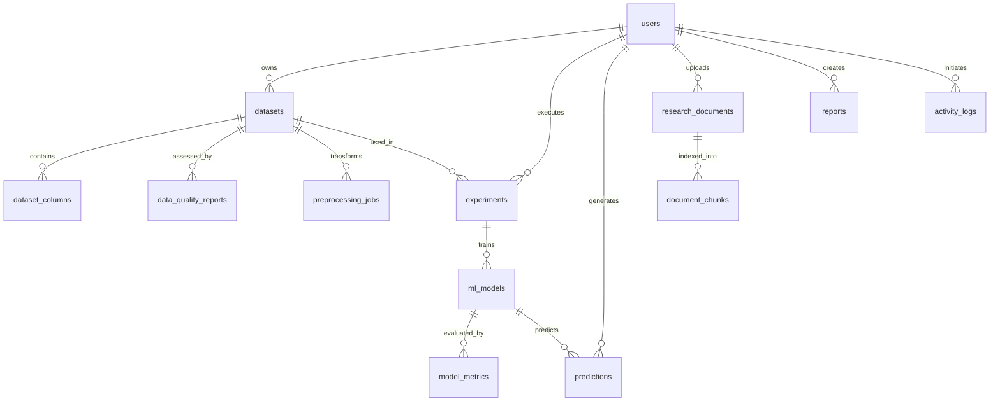

# MedInsight AI — Database Design & Entity Relationship Guide
**BioIntelliX | Team led by Mr. S. K. Shrivastav**  
*From Biomedical Data to Intelligent Insight.*

---

## 1. Database Connection & Configuration

MedInsight AI is configured to run against MySQL 8.0:
```python
import os

connection = mysql.connector.connect(
    host="localhost",
    user="root",
    password=os.environ["DB_PASSWORD"],
    database="medinsight_ai",
    port=3306
)
```
SQLAlchemy connection string format:
```
mysql+pymysql://<DB_USER>:<DB_PASSWORD>@localhost:3306/medinsight_ai
```

The application automatically provisions the database if it does not exist via `create_database()` in `backend/app/core/database.py`, using `utf8mb4` encoding and `utf8mb4_unicode_ci` collation.

---

## 2. Relational Schema & Tables

### 2.1 `users`
Stores credentials, institution details, and role-based permissions.
- `id` (INT, Primary Key, Auto Increment)
- `email` (VARCHAR 255, Unique, Indexed)
- `username` (VARCHAR 100, Unique, Indexed)
- `hashed_password` (VARCHAR 255)
- `full_name` (VARCHAR 255)
- `role` (ENUM: `'ADMIN'`, `'RESEARCHER'`, `'STUDENT'`)
- `is_active` (BOOLEAN, default TRUE)
- `is_verified` (BOOLEAN, default FALSE)
- `institution` (VARCHAR 255)
- `bio` (VARCHAR 1000)
- `created_at` / `updated_at` (DATETIME)

### 2.2 `datasets`
Tracks uploaded and registered biomedical tabular or signal datasets.
- `id` (INT, Primary Key)
- `name` (VARCHAR 255, Indexed)
- `description` (TEXT)
- `source` (VARCHAR 500)
- `file_format` (VARCHAR 20: `'csv'`, `'xlsx'`)
- `file_path` (VARCHAR 1000)
- `file_size_bytes` (INT)
- `num_rows` (INT)
- `num_columns` (INT)
- `license_info` (VARCHAR 500)
- `status` (ENUM: `'UPLOADED'`, `'PROCESSING'`, `'READY'`, `'ERROR'`)
- `owner_id` (INT, Foreign Key -> `users.id`)
- `created_at` / `updated_at` (DATETIME)

### 2.3 `dataset_columns`
Column-level schema statistics and metadata.
- `id` (INT, Primary Key)
- `dataset_id` (INT, Foreign Key -> `datasets.id`)
- `name` (VARCHAR 255)
- `dtype` (VARCHAR 50)
- `null_count` (INT)
- `unique_count` (INT)
- `min_value` / `max_value` / `mean_value` / `std_value` (FLOAT)
- `sample_values` (JSON)

### 2.4 `data_quality_reports`
Automated dataset quality assessments.
- `id` (INT, Primary Key)
- `dataset_id` (INT, Foreign Key -> `datasets.id`)
- `quality_score` (FLOAT: 0 to 100)
- `missing_pct` (FLOAT)
- `duplicate_count` (INT)
- `total_issues` (INT)
- `issues_json` (JSON)
- `column_quality_json` (JSON)
- `recommendations` (JSON)
- `created_at` (DATETIME)

### 2.5 `preprocessing_jobs`
Tracked data transformations and pipeline parameters.
- `id` (INT, Primary Key)
- `dataset_id` (INT, Foreign Key -> `datasets.id`)
- `config_json` (JSON: imputation, scaling, outlier policy)
- `status` (ENUM: `'PENDING'`, `'RUNNING'`, `'COMPLETED'`, `'FAILED'`)
- `result_dataset_id` (INT)
- `pipeline_path` (VARCHAR 1000)
- `error_message` (TEXT)
- `created_at` / `completed_at` (DATETIME)

### 2.6 `experiments` & `ml_models` & `model_metrics`
Machine learning training runs, hyperparameter logs, and evaluation metrics.
- `experiments`: `id`, `name`, `dataset_id`, `user_id`, `task_type` (`'CLASSIFICATION'`, `'REGRESSION'`), `target_column`, `feature_columns` (JSON), `status`.
- `ml_models`: `id`, `experiment_id`, `algorithm`, `hyperparams_json` (JSON), `artifact_path`, `pipeline_path`, `feature_names` (JSON), `training_duration_sec`.
- `model_metrics`: `id`, `model_id`, `metric_name` (`'accuracy'`, `'f1'`, `'roc_auc'`, `'rmse'`, etc.), `metric_value` (FLOAT), `split_type` (`'test'`, `'cv'`), `extra_data` (JSON: confusion matrix).

### 2.7 `predictions`
Auditable record of individual model inference queries.
- `id` (INT, Primary Key)
- `model_id` (INT, Foreign Key -> `ml_models.id`)
- `user_id` (INT, Foreign Key -> `users.id`)
- `input_features` (JSON)
- `output_prediction` (JSON)
- `explanation_summary` (JSON)
- `created_at` (DATETIME)

### 2.8 `research_documents` & `document_chunks`
Hierarchical RAG document index for the Biomedical Research Assistant.
- `research_documents`: `id`, `title`, `authors`, `year`, `source`, `doi`, `file_path`, `file_format`, `checksum`, `owner_id`, `status`, `word_count`.
- `document_chunks`: `id`, `document_id` (Foreign Key), `chunk_index`, `content` (TEXT), `keywords` (JSON), `page_number`.

### 2.9 `reports`
Generated PDF and export metadata.
- `id` (INT, Primary Key)
- `title` (VARCHAR 500)
- `report_type` (ENUM: `'PDF'`, `'CSV'`, `'XLSX'`)
- `file_path` (VARCHAR 1000)
- `experiment_id` (INT, Nullable)
- `user_id` (INT, Foreign Key -> `users.id`)
- `status` (ENUM)
- `created_at` (DATETIME)

### 2.10 `activity_logs`
Forensic audit trail of all platform operations.
- `id` (INT, Primary Key)
- `user_id` (INT, Nullable)
- `action` (VARCHAR 100: `'USER_LOGIN'`, `'DATASET_UPLOAD'`, `'MODEL_TRAIN'`, `'SIGNAL_ANALYSIS'`, etc.)
- `resource_type` (VARCHAR 50)
- `resource_id` (INT, Nullable)
- `details` (JSON)
- `ip_address` (VARCHAR 45)
- `created_at` (DATETIME)

---

## 3. Entity-Relationship Diagram (ERD)


